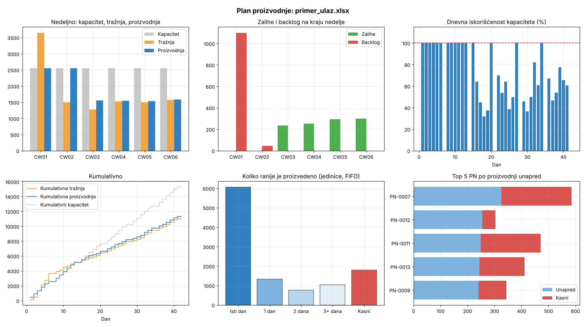

# Automated Production Planning System

Builds a daily production release plan from a demand forecast and a shared daily capacity. It minimizes backlog first and unnecessary inventory second, and it builds ahead only as far as it has to. The plan comes from an exact mixed-integer optimization model, not a heuristic, and it is implemented in both **MATLAB** and **Python**.



## Example

`data/primer_ulaz.xlsx` is a synthetic input: 15 part numbers over 6 weeks, with capacity of 450/day on weekdays, 300 on Saturday and 0 on Sunday. The first week has a demand peak of 3,650 units against 2,550 of capacity.

The planner:
- runs at full capacity from day 1 and builds ahead on days 1 and 2, before the peak hits;
- still cannot avoid backlog (up to 1,100 units at the end of week 1), and works it off by Monday of week 3;
- from week 3 on, produces close to demand and holds only the safety stock (20 per PN).

The complete plan is in [`results/plan_primer_ulaz.xlsx`](results/plan_primer_ulaz.xlsx).

## Model

For every part number *p* and day *d*:

| Variable | Meaning | Cost / unit / day |
|---|---|---:|
| x | release (production), integer | 0 |
| S | stock up to the safety-stock target | 0.1 |
| E | stock above the safety-stock target | 5 |
| B | backlog (demand not yet delivered) | 100 |
| U | shortfall below the safety-stock target | 1 |

Constraints:

- **Inventory balance**: (S + E − B)<sub>d</sub> = (S + E − B)<sub>d−1</sub> + x<sub>d</sub> − demand<sub>d</sub>
- **Soft safety stock**: S + U ≥ target, with 0 ≤ S ≤ target
- **Shared capacity**: Σ<sub>p</sub> x<sub>p,d</sub> ≤ capacity<sub>d</sub>

All costs are parameters. Because backlog costs 20 times as much as excess stock, building up to about 20 days ahead is still cheaper than being late. Lower `backlog_penalty` if you prefer to ship late rather than build early.

## Input format

The first sheet of the workbook, with data starting in column C:

```
        A                 B   C          D          ...
 1                            Kapacitet  Kapacitet
 2                            450        450          <- daily capacity
 8                            CW01                    (optional)
 9                            Pon        Uto          <- one column per day
11  PN-0001
12  Planned release                                   <- filled in by the planner
13  Planed order              0          37           <- demand
14  Cummulative                                       <- filled in: stock − backlog
15  PN-0002
...
```

## Output

`results/plan_<input>.xlsx` contains these sheets:
- **Plan**: the input sheet with *Planned release* and *Cummulative* filled in.
- **Dnevni pregled**: per day, capacity, demand, production, utilization, stock, backlog and status.
- **Nedeljni pregled**: the same totals per week.
- **Backlog**: backlog per PN per day.
- **Proizvodnja unapred**: per PN, how many units were made on the due day, 1, 2 or 3+ days early, or late (FIFO matching).

`results/plan_<input>.png` is the dashboard.

## Usage

### Python

```bash
python -m venv .venv
source .venv/bin/activate          # Windows: .venv\Scripts\activate
pip install -r requirements.txt

python -m planner                              # data/primer_ulaz.xlsx
python -m planner moj_plan.xlsx --safety-stock 0 --backlog-penalty 200
pytest                                         # tests
```

### MATLAB

```matlab
run('matlab/dugorocni_plan.m')
```

You need R2019a or newer and the Optimization Toolbox (`intlinprog`). Set the input file and the costs in the `config` block at the top of the script.

### New sample data

```bash
python scripts/make_sample_input.py --pns 20 --weeks 8 --seed 1
```

## Project structure

```
data/primer_ulaz.xlsx          synthetic sample input
planner/                       Python: io.py, model.py, analysis.py, plot.py, __main__.py
matlab/dugorocni_plan.m        MATLAB entry script (config + run)
matlab/*.m                     parse_plan_input, solve_plan, fifo_lead_buckets, write_plan_report, plot_plan
scripts/make_sample_input.py   sample data generator
tests/                         pytest tests
results/                       generated plan and dashboard
```

## Author

**Danilo Lazović**
- Production Planning Specialist @ BOSCH (Jan 2026 - Present)
- Student of Management and Organization - Operations Management
- Faculty of Organizational Sciences, University of Belgrade

## License

This project is available for educational and research purposes.
